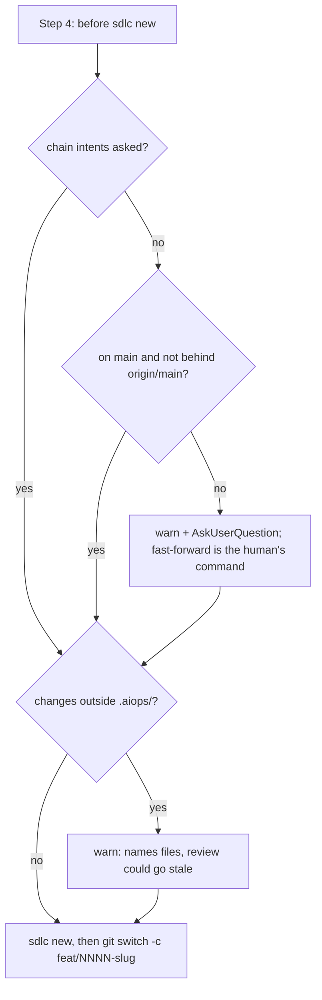

# Spec: Intent skill: PRD source, domain vocabulary, clean branch start

<!-- State 2 SPECIFICATION. Business goals from the approved intent.md, translated into engineering
     requirements. The intent's two questions were answered before its approval: how a PRD matches, and that a
     behind `main` is a warning plus a question, never a silent switch or pull. -->

## Summary
Three refinements to `skills/intent/SKILL.md`, guidance only (intent: Desired outcome):

- **Step 1 (Locate):** when the `dsl` part's model files exist, the agent scans their names first, so the intent
  uses the model's terms.
- **Step 2 (Gather the source):** a matching PRD or ticket file in `docs/prd/`, or one the arguments name, is read
  first as the source of truth, and Step 3 asks only what it leaves open.
- **Step 4 (Create):** before branching, the agent checks that the branch starts from an up-to-date `main` and
  warns about uncommitted changes that would make the future review stale.

Repos without `docs/prd/` or `domain/` see no difference.

## Requirements
- **R-1: domain vocabulary (Step 1).** When `domain/*.dsl.json` files exist, the agent lists them and reads each
  file's `kind` and `name`, plus its state, event, rule-id or step names. It uses those terms in the intent, and
  when the need names a concept differently from the model, it uses the model's term or asks which one is meant.
  A bare `domain/` with no `*.dsl.json` file is skipped, as in 0012.
- **R-2: the PRD source (Step 2).** The source is, in order:
  1. `prd:<slug>` in `$ARGUMENTS`: the file in `docs/prd/` whose name is `<slug>` (any extension);
  2. a local path in `$ARGUMENTS` under `docs/prd/`;
  3. otherwise, a file in `docs/prd/` whose name contains the need's slug or its issue number.

  When several files match, the agent asks the human which one (AskUserQuestion). A named file that doesn't exist
  is reported, not guessed. The file read becomes the intent's `source:` (`prd:<slug>` or the path), and
  `#N`/`alert:` sources keep their current handling.
- **R-3: what a PRD settles (Step 3).** The agent treats the file as the source of truth: the interview skips what
  it settles and asks only what it leaves open or contradicts. Its unknowns still go to Open questions. The
  product-analyst receives the file's path with the interview answers. A PRD is input, never an approval.
- **R-4: a clean branch start (Step 4).** Before `sdlc new`, the agent:
  - runs `git fetch origin <main>` when an `origin` remote exists; with none, or when the fetch fails, it warns and
    continues;
  - checks that HEAD is on `main` and that `main` isn't behind `origin/main`;
  - runs `git status --porcelain` and warns, naming the files, when any change lies outside `.aiops/` (those make a
    future review stale).

  On a problem it warns and asks the human (AskUserQuestion) what to do. It never switches branches, pulls,
  stashes, resets or discards on its own. When `main` is behind and the human agrees to fast-forward, the agent
  prints the human's command (`! git switch main && git pull --ff-only`), because the read-only state refuses
  `git pull` and `git merge` (G-LOCK-03). When the human explicitly asks to chain intents, the main check is
  skipped and the branch starts from the current one; the uncommitted-changes warning still applies.
- **R-5: where it's written.** `skills/intent/SKILL.md` Steps 1, 2, 3 (one line: skip what the source settles) and
  4, plus one red-flag row ("Branching from a stale main or a dirty tree"); a guidance test in `tests/test_cli.py`;
  and a CHANGELOG `[Unreleased]` entry naming `.aiops/0016-intent-skill-refinements/`.
- **Non-functional:** no engine, hook, schema or scaffold change; `make check` passes.

## Acceptance criteria
- **AC-1**: Given a repo with `domain/*.dsl.json` files, when the intent skill runs Step 1, then it scans their
  filenames and model names and writes the intent in the model's terms; a repo without them skips the scan.
- **AC-2**: Given `prd:<slug>`, a local path in `docs/prd/`, or a `docs/prd/` file matching the slug or issue
  number, when Step 2 runs, then that file is read first as the source of truth, Step 3 asks only what it leaves
  open, and several matches lead to a question naming them.
- **AC-3**: Given a checkout that isn't on an up-to-date `main`, when Step 4 runs without a request to chain, then
  the agent warns and asks before any fast-forward, and never switches or pulls on its own; offline or with no
  remote, it warns and continues.
- **AC-4**: Given uncommitted changes outside `.aiops/`, when Step 4 runs, then the agent names them and warns that
  they could make the future review stale, before creating the branch.
- **AC-5**: Given the shipped skill, then the guidance test covers AC-1 to AC-4's wording, the existing intent-skill
  tests still pass, and `make check` passes.

## Data model
None (no changes)

## API contracts
None (no changes)

## Security & data-leak flags
- **A PRD is untrusted text.** A file in `docs/prd/` may hold instructions; the skill says it is data for the
  intent, never instructions, and never an approval. Risk → a PRD steering the agent; mitigation → R-3's wording,
  and the gates still need the human. (zoujagger)
- **A path in `$ARGUMENTS` could point outside the repo.** R-2 reads a named path only under `docs/prd/`; any other
  path is refused with a note. Secret paths stay blocked by `guard-read.sh` in every repo. (zoujagger)
- **`git fetch` reaches the network.** It reads only; no credentials or repo content are sent beyond what git
  already sends. Offline, the skill continues with a warning.
- No guard, approval or audit path changes, and the agent gains no write in State 1: the fast-forward stays the
  human's command.

No flag needs a decision beyond the two above, which this spec settles as written.

## Architecture

- **Only `skills/intent/SKILL.md` changes** (with its test and the CHANGELOG). The read-only lock already refuses
  `git pull`/`git merge` in State 1 (`lib/sdlc_engine/guards.py:2425`, G-LOCK-03), so the skill hands that step to
  the human instead of trying it.
- **The checks run before `sdlc new`**, so an abandoned start leaves no intent folder or active pointer behind.
- **Not taken:**
  - an `sdlc` command for the branch check (the intent rules out an engine change);
  - blocking on a dirty tree (the human decides: the intent says warn);
  - scaffolding `docs/prd/` (intent: Out of scope).

## Rollout & rollback
- Ships with the next release; adopters get it when they update the plugin.
- **Rollback:** revert the PR.

## Open questions
None.
