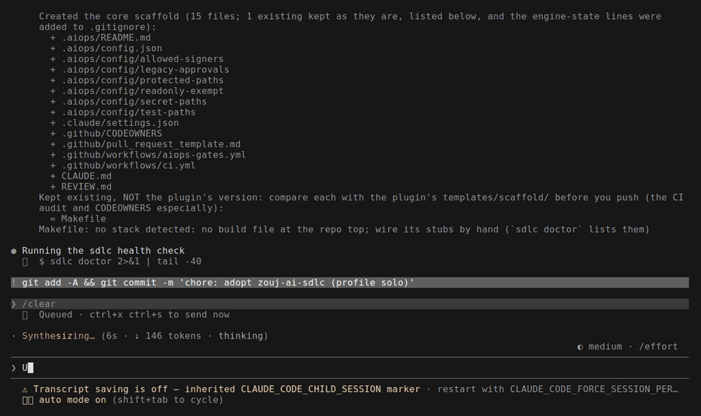
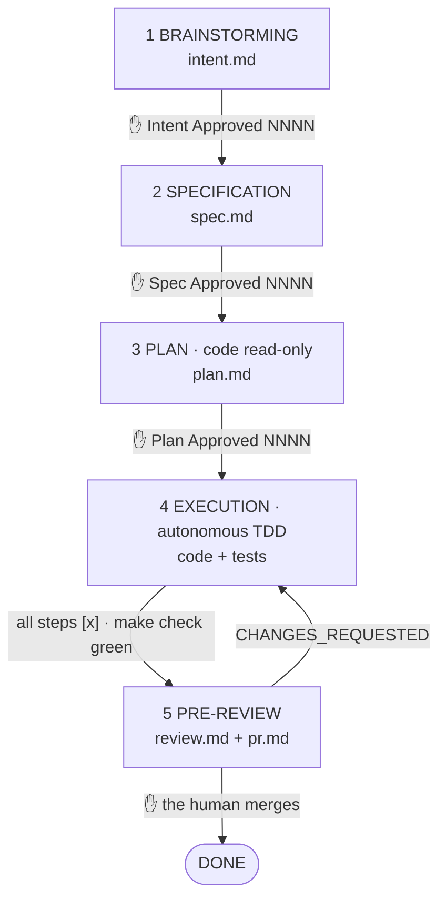

# zouj-ai-sdlc

> **Status: 0.2.0.** The gates, the guards and the artifact formats are stable within 0.2.x; the
> [CHANGELOG](CHANGELOG.md) names every change. Feedback welcome.

<p align="center"></p>

**Demo:** Claude is blocked from writing code before a plan exists. The human opens each gate by typing `Intent Approved 0001`,
`Spec Approved 0001` and `Plan Approved 0001`, and Claude then runs TDD to a green `make check` and a review.

**Coding agents skip steps.** They write code before anyone agreed on what to build, approve their own plans, and
call work done when the tests are red. Instructions in a prompt ask them not to; nothing stops them.

zouj-ai-sdlc is a [Claude Code](https://code.claude.com) plugin that runs your software lifecycle as a **state
machine over Markdown artifacts versioned in Git**, modeled on Anthropic's *AI-Native SDLC Playbook*. Work starts
from an intent, every state commits an artifact the next one reads, and **humans decide at every gate**. Hooks
enforce those gates instead of relying on the model's good behaviour.



## Start using
Start from what you're doing. Every route runs the same playbook workflow, with a human at every gate.

| You want to… | Run | Playbook stage |
|---|---|---|
| Try the workflow first | a throwaway repo: see **Just looking?** under Quick start | (any, risk-free) |
| Set up this repo | type `/zouj-ai-sdlc:setup solo` (or `team`, `strict`) | (once per repo, before the loop) |
| Build a feature or change | `/zouj-ai-sdlc:intent "<need>"` → spec → plan → implement | Plan → Design → Build |
| Fix a bug | `/zouj-ai-sdlc:fix "<bug>"` (failing test first) | Test |
| Act on an alert or issue | `/zouj-ai-sdlc:triage alert:<metric>` → a new intent | Maintain → Plan (a new intent) |
| Get a branch reviewed | `/zouj-ai-sdlc:review`, then `/zouj-ai-sdlc:pr` | Deploy: AI review |
| See where you are and what's next | `/zouj-ai-sdlc:status` | any |
| Upgrade, repair or remove the setup | `sdlc list-installed`, then `sdlc upgrade`, `repair` or `uninstall --dry-run` | Maintain |
| Understand a block | `sdlc why <id>` (the id is in `BLOCKED [G-…]`) | any |
| Run a human-only command in your own terminal | `sdlc where` prints it with the plugin's full path | any |
| Not sure | `/zouj-ai-sdlc:help-me "<what you want>"` | any |

All commands: [COMMANDS-QUICK-REF.md](COMMANDS-QUICK-REF.md). Stuck? [TROUBLESHOOTING.md](TROUBLESHOOTING.md) or
`sdlc feedback`.

## Quick start
Requirements: `git`, `make`, `python3` ≥ 3.9 (stdlib only), Claude Code ≥ 2.1.

Install the plugin once (A or B), then configure each repo that should use it.

**A. Marketplace (recommended).** Installs a pinned release; Claude Code keeps it in its plugin cache.
1. Start Claude Code anywhere and add the marketplace at a release tag:
   ```text
   /plugin marketplace add zoujagger/zouj-ai-sdlc@v0.2.0
   ```
2. Install the plugin from it:
   ```text
   /plugin install zouj-ai-sdlc@zouj
   ```
   From a terminal instead:
   ```bash
   claude plugin marketplace add zoujagger/zouj-ai-sdlc@v0.2.0
   claude plugin install zouj-ai-sdlc@zouj
   ```
3. Restart Claude Code and check it's enabled: `/plugin list` shows `zouj-ai-sdlc@zouj`.

**B. From a clone of the repository.** For trying a branch, contributing, or a machine without marketplace access.
1. Clone it and check out a release tag:
   ```bash
   git clone https://github.com/zoujagger/zouj-ai-sdlc.git ~/src/zouj-ai-sdlc
   git -C ~/src/zouj-ai-sdlc checkout v0.2.0
   ```
2. Either load it for one session, from your project:
   ```bash
   cd ~/code/my-app
   claude --plugin-dir ~/src/zouj-ai-sdlc
   ```
   or install it for good, using the clone as a local marketplace (in Claude Code):
   ```text
   /plugin marketplace add ~/src/zouj-ai-sdlc
   /plugin install zouj-ai-sdlc@zouj
   ```
3. To move to a newer release later: `git -C ~/src/zouj-ai-sdlc fetch --tags && git -C ~/src/zouj-ai-sdlc checkout
   <tag>`, then `/plugin marketplace update zouj` if you installed it from the local marketplace.

**Configure a repo** (with either install). In a git repo with at least one commit, start `claude`, then:
1. Optional: type `/zouj-ai-sdlc:setup` alone to check the prerequisites and preview every change.
2. Type the setup command as your whole prompt, with a profile (`solo`, `team` or `strict`, table below):
   ```text
   /zouj-ai-sdlc:setup solo
   ```
   It writes the core scaffold (missing files only), sets the repo's first profile and commits `.aiops/config.json`
   alone. Claude can't do this step for you.
3. Review the files the reply lists, then commit them with the command it gives, for example:
   ```text
   ! git add -A && git commit -m "chore: adopt zouj-ai-sdlc (profile solo)"
   ```
4. Wire the Makefile contract if the reply lists commands for your stack. Run this in your own terminal (`sdlc where`
   prints the full path for `<plugin>/bin/sdlc`):
   ```bash
   /usr/bin/python3 -I <plugin>/bin/sdlc setup --stack auto --yes
   ```
5. Check and start: `/zouj-ai-sdlc:status` shows the state card, then
   `/zouj-ai-sdlc:intent "add a health endpoint"` starts your first intent.

Changing a profile later is a run in your own terminal: `sdlc setup --profile solo|team|strict`.

**Just looking?** Try it in a throwaway repo:
`mkdir /tmp/sdlc-try && cd /tmp/sdlc-try && git init -q && git commit -q --allow-empty -m init`, start `claude` there
and type `/zouj-ai-sdlc:setup solo`. Commit the scaffold with the command the reply gives
(`git add … && git commit -m "chore: adopt zouj-ai-sdlc (profile solo)"`). Then run
`/zouj-ai-sdlc:intent "greet people in French"`, walk the five states, and delete the directory.

| Profile | Approval proof | For |
|---|---|---|
| `solo` | the typed phrase + an unsigned approval commit | one developer, trying it out |
| `team` | an SSH-signed commit, a human per signature ([approver setup](docs/approver-setup.md)) | most teams |
| `strict` | an `sk-` key touch per signature, plus CODEOWNERS on `/.aiops/` | regulated or high-risk repos |

**Good to know:**
- **Profiles:** they change only how an approval is proven; every gate is the same. Choose with
  `/zouj-ai-sdlc:setup solo|team|strict`. Under `team` and `strict` you approve with a signing key, from your own
  terminal: `/usr/bin/python3 -I <plugin>/bin/sdlc approve NNNN intent|spec|plan`
  ([approver setup](docs/approver-setup.md)). The escape hatch `"approval_key_policy": "any"` accepts any key, at a
  cost: anything running as you can then sign approvals.
- **The Makefile contract:** setup detects the stack at the repo top (Java/Spring Boot with Maven or Gradle, Node,
  React, Angular, Python, Go) and wires `make check` from the repo's own commands. Only a `setup` or `init` you run
  yourself wires it. Run by Claude, or as the typed `/zouj-ai-sdlc:setup`, they list the commands and the terminal
  command that wires them, so the repo's scripts never run before you've read them. Override the guess with
  `--stack <name>`, or keep the stubs with `--stack none`. A Makefile you've edited is never changed.
- **Opt-in parts:** setup installs the core only. Add `review`, `maintain`, `deploy`, `governance`, `issues` or `dsl`
  with `sdlc setup --with <part>`. `dsl` keeps a validated, domain-neutral model of state machines, rules and
  workflows in `domain/`, and every later spec must say what it changes there; `--with all` installs every part
  but `dsl`.
- **Your own terminal:** `sdlc` is on PATH only inside Claude Code. `sdlc where` prints the command to run there.
- **Without `.aiops/`:** the gates are dormant, but the safety guards are always on.

**C. For a team, declaratively.** Commit this to `.claude/settings.json` (setup writes it), and Claude Code offers
the plugin to everyone who opens the repo:
```json
{
  "extraKnownMarketplaces": {
    "zouj": { "source": { "source": "github", "repo": "zoujagger/zouj-ai-sdlc", "ref": "v0.2.0" } }
  },
  "enabledPlugins": { "zouj-ai-sdlc@zouj": true }
}
```

> **What you trust:** enabling the plugin trusts github.com/zoujagger/zouj-ai-sdlc at that ref. Its hooks run as you
> on every tool call, so every command here pins a release tag. Official sources only: this repository and the
> plugin id `zouj-ai-sdlc@zouj`.

Everything else (the terminal-only install, the parts table, configuration): [docs/install.md](docs/install.md).

## How it works
| State | You run | The agent produces | Leaves the state when |
|---|---|---|---|
| 1 BRAINSTORMING | `/zouj-ai-sdlc:intent "<need>"` | a targeted clarification interview → `.aiops/NNNN-slug/intent.md` (3 to 5 outcomes; it asks you to split anything bigger) | you type **`Intent Approved NNNN`** |
| 2 SPECIFICATION | `/zouj-ai-sdlc:spec` | `spec.md`: requirements, 3 to 5 ACs, **DB schema, API contracts, security and data-leak flags**, each table and endpoint tagged `[AC-N]` | you type **`Spec Approved NNNN`** |
| 3 PLAN | `/zouj-ai-sdlc:plan` | `plan.md`: chronological file-by-file steps, risks, test definitions. **Code is read-only** | you type **`Plan Approved NNNN`** |
| 4 EXECUTION | `/zouj-ai-sdlc:implement` | per step: proof test → see it fail → code → green, on `feat/NNNN-slug`, no questions asked | every step ticked, `make check` green |
| 5 PRE-REVIEW | `/zouj-ai-sdlc:review` | fresh-context verifier, code-reviewer and security-reviewer → `review.md` (score /100) + `pr.md` | **you** merge (the agent can't) |

`sdlc status` (or `/zouj-ai-sdlc:status`) always shows the state, who it's waiting on, and the exact next step.
The state is **derived** from the artifacts and git, never stored.

**Small, reviewable specs.** `sdlc validate` warns when a spec has more than 5 ACs and refuses a draft with more than
8, so an epic gets split before it reaches you. Sections with nothing to change read `None (no changes)`, a flow or a
new table gets one Mermaid diagram (12 lines at most, checked), and stored data comes with its query patterns,
indexes and N+1 prevention. With the `dsl` part, the spec starts from the domain model (`## Domain DSL`) and the
review flags rules hardcoded outside it. Details: [docs/sdlc.md](docs/sdlc.md#keeping-the-work-reviewable).

## How it differs from prompt-only workflows
Skill and prompt workflows describe a good process and hope the model follows it. Here the process is enforced:

| | Prompt-only workflow | zouj-ai-sdlc |
|---|---|---|
| Who opens a gate | the model decides it's ready | only a human, by typing `Plan Approved NNNN` as the whole prompt |
| Enforcement | advice in the context window | hooks that block the tool call (`BLOCKED [G-…]`, `sdlc why <id>`) |
| Planning states | the model may start coding early | code is read-only until the plan is approved |
| Where state lives | the conversation | derived from Markdown artifacts and git on every call |
| Definition of done | the model says so | the Stop hook requires `make check` green |
| Audit | none | CI traces every open gate to a signed, single-file approval commit |
| Drift | a changed plan goes unnoticed | editing an approved artifact re-closes its gate |

Local hooks are a strong deterrent, not a sandbox; the signed-approval CI audit is the hard guarantee. Details:
[what is enforced](docs/enforcement.md) · [threat model](docs/architecture.md#threat-model).

## Lifecycle
`init` and `setup` record what they wrote, including the opt-in parts, in `.aiops/install-state.json`. After a plugin
update, `sdlc upgrade` refreshes the scaffold; `sdlc repair` restores missing files; `sdlc uninstall --dry-run` shows
what removal would delete. Your modified files are never touched. Blocked by mistake? `sdlc why <id>` explains the
rule. Details: [docs/lifecycle.md](docs/lifecycle.md).

## Develop
```bash
make check        # lint + compile + unit, hook and playbook-conformance tests
make validate     # claude plugin validate .
make dev          # claude --plugin-dir .
make evals        # behavioural evals against a live model
```
Docs: [install](docs/install.md) · [approver setup](docs/approver-setup.md) · [enforcement](docs/enforcement.md) ·
[lifecycle](docs/lifecycle.md) · [state machine](docs/state-machine.md) · [architecture](docs/architecture.md) ·
[playbook mapping](docs/sdlc.md) · [governance](docs/governance.md) · [adoption ladder](docs/adoption.md) ·
[roadmap](docs/roadmap.md) · [worked example](docs/examples/0001-csv-export/).
This repo dogfoods itself:
see [`.aiops/0001-zouj-ai-sdlc-plugin/`](.aiops/0001-zouj-ai-sdlc-plugin/).

## License and copyright
Copyright (c) 2026 Ulrich-Jagger Z.O. This copyright covers the plugin's own code and documentation, not any
third-party component.

From 0.2.0, zouj-ai-sdlc is distributed under the GNU Affero General Public License v3.0 or later
(AGPL-3.0-or-later): see [LICENSE](LICENSE). Releases up to and including 0.2.0-beta.4 were published under the MIT
License and remain available under those terms.

- **No bundled third-party code.** The engine uses only the Python standard library; tools the plugin calls (`git`,
  `make`, `python3`, `gh`, Claude Code) are installed separately under their own licenses.
- **References, not copies.** The workflow is modeled on Anthropic's *AI-Native SDLC Playbook*, and the skills
  follow the Superpowers style; neither one's text is included here. Claude and Anthropic are trademarks of
  Anthropic, PBC; this project isn't affiliated with or endorsed by Anthropic.
- **Scaffolded files** that `sdlc init` and `sdlc setup` write into a project come from `templates/` and carry no
  license or copyright header.
