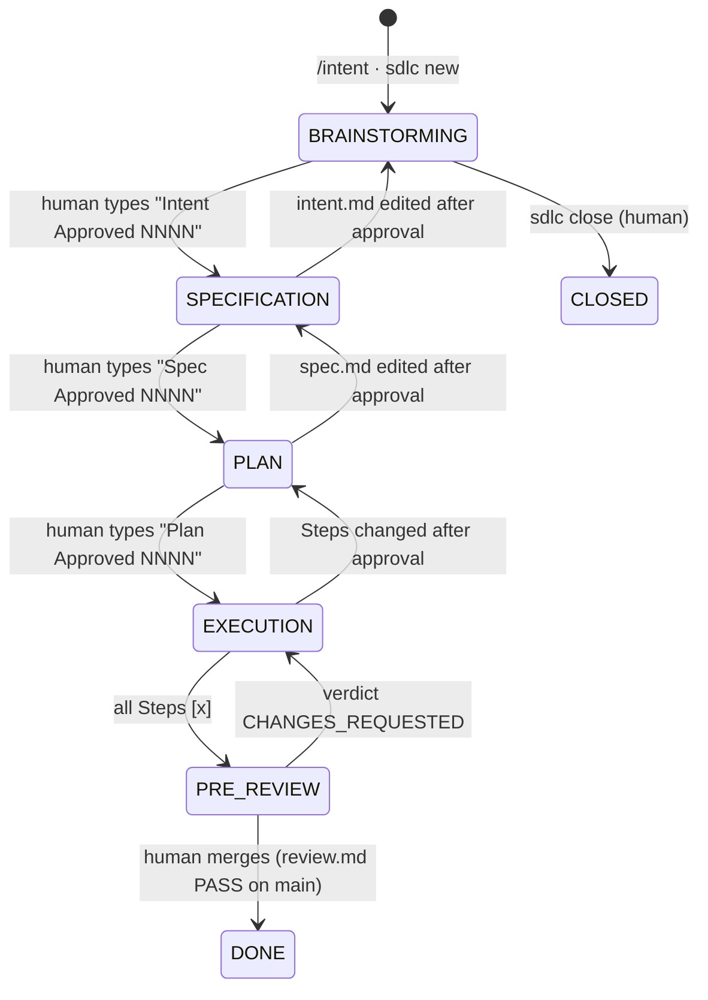

# State machine

The engine (`lib/sdlc_engine/machine.py`) **derives** each intent's state from `.aiops/NNNN-slug/*.md` and git on
every call. Nothing is stored, so the state can't drift from the artifacts.



## Evaluation order
The first failing check decides the state:

| # | State | Condition | Waiting on | Code writable? |
|---|---|---|---|---|
| 0 | CLOSED | intent `status: Closed` | none | per `lock_when_idle` |
| 1 | BRAINSTORMING | intent gate closed (missing, Draft, or stale) | agent, then the human | **no** |
| 2 | SPECIFICATION | spec gate closed | agent, then the human | **no** |
| 3 | PLAN | plan gate closed | agent, then the human | **no** |
| 4 | EXECUTION | a `## Steps` checkbox isn't `[x]` | agent | yes |
| 5 | PRE-REVIEW | no review.md, CHANGES_REQUESTED, stale, or PASS awaiting the merge | agent / human | yes |
| 6 | DONE | review.md with PASS exists on the main branch, and you're on main | none | per `lock_when_idle` |

**Gate open** = `status: Approved` **and** `approved-sha256` equals the current body hash. For plan.md, the hash
ignores checkbox state and the `## Deviation log` section, so progress doesn't void the approval but changing the
Steps does. **Review stale** = files outside `.aiops/` changed (committed or not) after `review.md`'s `commit:`.

## Active intent
`$AIOPS_INTENT` → the branch name (`(feat|fix|…)/NNNN-…`) → `.aiops/state/active` (set by `sdlc new` / `sdlc use`).
With no active intent and `lock_when_idle: true` (the default), code is read-only, so every change starts from an intent.

## Approval record
```yaml
status: Approved
approved-by: Jane Doe <jane@example.com>      # git config of the human's checkout
approved-at: 2026-10-30T14:02:11Z
approved-via: prompt                           # prompt (UserPromptSubmit) | cli (sdlc approve in a terminal)
approved-sha256: 3f1c…                         # body hash at approval time
```
With `commit_approvals: true`, the file is committed **alone** as `chore(aiops): Plan Approved NNNN`, with the
trailer `AIOps-Approval: plan NNNN sha256=…`. `sdlc validate --ci` traces each open gate to that commit and fails if
it's missing or co-authored by Claude.

## Schemas
`schemas/{intent,spec,plan,review}.json` define the required front matter, statuses, required `##` sections,
the upstream artifact (`requires`), and the cross-checks:

| Check | Rule |
|---|---|
| `has_acceptance_criteria` | spec `## Acceptance criteria` contains ids `AC-1…` |
| `has_steps` | plan `## Steps` contains checkboxes |
| `covers_spec_acs` | plan and review reference every spec AC id |
| `valid_verdict` | review `verdict` is PASS or CHANGES_REQUESTED, and `commit` is a sha |
